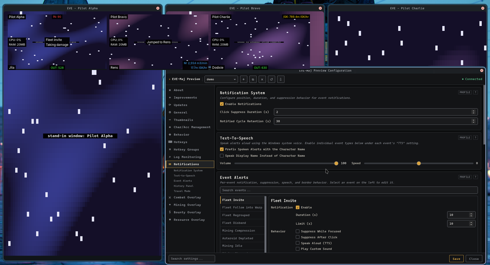

# EVE-Maj Rusty

A Rust port of [EVE-Maj Preview](https://github.com/1234nin4321/EveMajImproved), the lightweight tool that shows live
thumbnail previews of EVE Online client windows: DWM thumbnails on Windows, and a native Wayland front end for
[Hyprland](https://hyprland.org) on Linux. Profiles (`profiles/*.json`) use the same format as the Zig build, so an
existing install's settings carry over.

> Work in progress.
> - **Windows:** Milestone 1 (thumbnails, clicking, dragging/snapping, layouts, notifications, tray, profile switching)
>   is ported; hotkeys, chatlog monitoring and its overlays, the client list and history panels, region selection and
>   `config.exe` are not yet.
> - **Linux (Hyprland):** thumbnails, layouts, hotkeys and groups, minimize/close all, auto-move, tray, `evemajpreview://`
>   links, chat-log monitoring (system names, notifications, sounds, Travel Mode) and the activity overlays (DPS,
>   mining, bounty, CPU/RAM), the Client List view and History Panel, and the settings window (`eve-maj-config`) with
>   region selection, Identify Displays and update checks all work. See [Linux (Hyprland)](#linux-hyprland).
>
> Unported settings still load and save, and log a warning when enabled.

## Layout

| Crate | What it is |
|---|---|
| `crates/core` | Platform-independent model: config, logging, protocol URL parsing, trackers, accounts, update checks. Unit-tested on any host. |
| `crates/win` | Thin helpers over the Win32 API (windows, monitors, clipboard, shell, file pickers). |
| `crates/app` | Windows subsystems shared by both binaries: IPC, sound, TTS, updater, displays, mouse hook. |
| `crates/preview` | The `eve-maj-preview` binary: the Windows app (`src/*.rs`) and the Linux/Hyprland front end (`src/linux/`). |
| `crates/config` | The `eve-maj-config` settings window for Linux: the shared dialog page (`ui/`) in a WebKitGTK window. |

`assets/` holds the embedded Cascadia fonts and the app icon.

## Building

Windows binaries cross-compile from Linux with the MinGW toolchain:

```sh
rustup target add x86_64-pc-windows-gnu
sudo apt install gcc-mingw-w64-x86-64   # provides the linker and windres
cargo build --release                   # default target is x86_64-pc-windows-gnu (.cargo/config.toml)
cargo t                                 # unit tests on the Linux host
```

On Windows, `cargo build --release --target x86_64-pc-windows-gnu` (or `-msvc`) works the same way.

## Linux (Hyprland)



*Demo setup: the "clients" are stand-in windows and the pilots, systems and log lines are made up. More screenshots
are in [docs/screenshots/linux](docs/screenshots/linux).*

`eve-maj-preview` also runs natively on Linux under [Hyprland](https://hyprland.org). Each thumbnail is a
wlr-layer-shell overlay (so it stays above fullscreen clients); Hyprland renders the EVE window straight into a GPU
buffer (`hyprland-toplevel-export-v1` + dmabuf) that is drawn into the thumbnail without passing through the CPU, with
the same text/border overlay as on Windows. Layout, styling and hotkey logic come from the same `core` code, so profiles
behave the same.

```sh
sudo pacman -S --needed rust wayland mesa libdrm cairo pango gtk3 webkit2gtk-4.1 xdg-utils wl-clipboard   # Arch; any distro with these works
cargo linux                                                    # = build --release for x86_64-unknown-linux-gnu
./target/x86_64-unknown-linux-gnu/release/eve-maj-preview      # --profile NAME.json, --fps N (default 30)
./target/x86_64-unknown-linux-gnu/release/eve-maj-config       # settings window; optional NAME.json
```

To install, put both binaries in the same directory, e.g. on your `PATH` (each one starts the other, looking next to
itself first and then on `PATH`):

```sh
install -Dm755 -t ~/.local/bin target/x86_64-unknown-linux-gnu/release/eve-maj-{preview,config}
```

Start `eve-maj-preview` from your Hyprland config (`exec-once = eve-maj-preview`), or turn on Run on Startup in the
settings window, which writes an XDG autostart entry (Hyprland runs those only through uwsm or a tool such as `dex`).

- Profiles, `accounts.json` and `eve-maj.log` live in `~/.config/eve-maj/` (the Windows build keeps them next to the
  .exe). Edits to the active profile's JSON are picked up while it runs.
- EVE clients are found by the default window filter: the Wine/Proton process image `exefile.exe` (or a window class
  of that name). A filter's `class_names` also match Hyprland window classes, e.g. `steam_app_8500`.
- Left-click focuses a client, right-drag moves a thumbnail, Ctrl+right-drag moves them all, Shift+click toggles
  cycle exclusion. `display.monitorIndex` counts Hyprland monitors by id; with none set, `startX`/`startY` are relative
  to monitor 0.
- **Hotkeys**: every hotkey from the profile and `global.settings.json` (groups, per-character, account keys, profile
  switching, cycling, minimize/close all, suspend, app and URL keys, mouse side buttons) is registered as a Hyprland
  bind while the app runs and removed when it exits. They show up in `hyprctl binds` as "EVE-Maj: ...".
- **Minimize** parks a client on the hidden `special:evemaj` workspace; clicking its thumbnail or cycling to it brings
  it back to the current workspace. Clients on a special workspace that isn't shown count as minimized.
- **Auto-move** floats a client and moves it to its saved window position. Save the current positions from the tray
  ("Save Client Window Positions") or per character in the settings window.
- **Settings window** (`eve-maj-config`): the same settings dialog as on Windows (its HTML/CSS/JS, every tab and
  language), in a native WebKitGTK window. Open it from the tray (click the icon, or Settings…) or run it directly.
  Saving updates the running app; live preview, Test Notification, profile switching and pausing hotkeys while a key
  is being recorded all reach the running app over its instance socket. `runOnStartup` writes an XDG autostart entry.
- **Identify Displays** (Display Config tab) shows each monitor's number in its top-left corner for three seconds, via
  `eve-maj-preview --identify-displays`, so it works whether or not the app is running.
- **Updates**: the settings window checks GitHub releases (unless update checks are disabled) and links to a newer
  one. Releases ship the Windows zip, so downloading and installing in place is Windows-only; update a Linux build by
  rebuilding it or through its package.
- **Region selection** ("Drag Select Region" and editing a region in the settings window) dims every monitor: drag a
  rectangle, then drag its edges or inside to adjust; Enter or Save keeps it, Esc, right-click or Cancel drops it. The
  app hands the result back to the settings window through `$XDG_RUNTIME_DIR/eve-maj-region-select.json`.
- **View modes**: Thumbnails, Client List (a compact panel with one row per client: status dot, name, and the newest
  notification, live stats or system name) or Nothing (clients are tracked, hotkeys and notifications keep working).
  Click a list row to focus that client, Shift+click to toggle its cycle exclusion.
- **History Panel** (`showNotifInfoPanel`): the latest notifications across all characters, with relative times and
  FLT/MIN/CBT/NAV/GEN filter buttons; click a row to focus that client. It hides while nobody is logged in when
  `hideNotifInfoPanelWhenNoCharacters` is set. Both panels are dragged by their header, snap like thumbnails, and
  remember their position when the profile says to.
- **Tray icon** (any StatusNotifierItem host: Waybar, KDE, ...): settings, profiles, dragging/auto-minimize/travel/visibility
  toggles, restore positions, show/clear the history panel, suspend hotkeys, close all, exit.
- **`evemajpreview://` links** work like on Windows: the app registers itself as the handler (`autoRegisterProtocol`),
  and a second start with a link (`eve-maj-preview --protocol URL`, or `xdg-open URL`) forwards it to the running instance.
- **Chat-log monitoring** (`chatlog.enabled`): system names, notifications (fleet invites, scrams, decloaks, cargo
  full, jumps, ...) and Travel Mode's left-behind alert, from EVE's chat and game logs. When `chatlogDir`/`gamelogDir`
  don't exist, the logs are found in the running client's Wine prefix (`WINEPREFIX`, or Proton's
  `STEAM_COMPAT_DATA_PATH/pfx`) under `drive_c/users/*/Documents/EVE/logs`.
- **Activity overlays** (`combat`, `mining`, `bounty`, `resources` sections): incoming/outgoing DPS, mining m3 and
  ISK rates, bounty ISK rate (all from the game log, so they need chat-log monitoring on) and each client's CPU/RAM
  (from `/proc`; VRAM isn't available on Linux), with the Taking damage, Laser idle and Mining stopped alerts.
- **Notification sounds** play through `ffplay`, `mpv`, `pw-play` or `paplay` (WAV/MP3; Windows `C:\...` paths from a
  copied profile are skipped); **spoken alerts** use `spd-say` (speech-dispatcher) or `espeak-ng`.
- Optional `hyprland.conf` rule: `layerrule = noanim, eve-maj-preview`.
- Thumbnail refresh rate is `--fps` (default 30): unlike DWM, every refresh is a GPU copy done by Hyprland, so lower it
  if you run many clients.

## License

GPL-3.0, like the project it is ported from. The bundled Cascadia fonts are under the SIL Open Font License
(`CascadiaCode-LICENSE.txt`).
